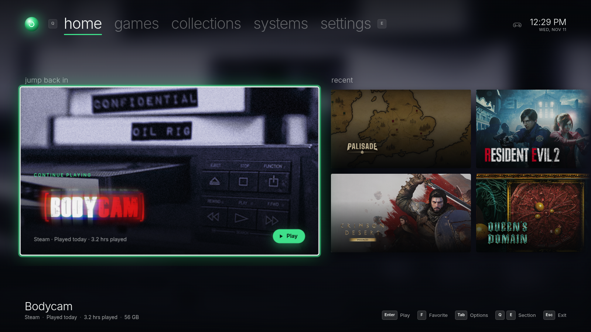

# Halcyon

A console-style game launcher for Linux. Big tiles, horizontal rails, and a dashboard you can drive
entirely from a controller. Steam, emulators and anything else you can start from a command.



## Run

```bash
npm install
```

```bash
npm start
```

`npm run windowed` starts in a window instead of fullscreen. `scripts/install-desktop.sh` adds
Halcyon to your application menu.

## Controls

| Action | Controller | Keyboard |
| --- | --- | --- |
| Move | D-pad / left stick | Arrow keys |
| Select / play | A | Enter |
| Back | B | Esc |
| Favorite | X | F |
| Game options | Y | Tab |
| Switch section | LB / RB | Q / E |
| Page the wall / cycle category | LT / RT | PgUp / PgDn |
| Search | Start | / |
| Sort | Select | Home |
| Guide | Home / Guide button, or B on home | G or F1 |
| In-game menu | Home, or Select + Start (hold Home to quit) | – |
| Fullscreen | – | F11 |

Controllers can be plugged in or removed at any time. Input is ignored while Halcyon is in the
background, so playing a game never moves the dashboard. Text entry uses an on-screen keyboard and
file picking uses a built-in browser, so no mouse or keyboard is ever required.

## Console behaviour

- **Guide** — opens from anywhere on the Home button (G or F1 on a keyboard) as a set of blades,
  like the console's: *games & apps* (recent games, all games), *home* (Halcyon Home, downloads,
  search, store, collections, and Resume / Quit for a running game), *downloads* (a live progress
  card and what's next) and *settings* (volume, settings, sleep, restart, shut down, exit). Left /
  right or LB / RB move between blades; Y goes to Halcyon Home. If Steam is running it may claim
  the Guide button for itself; B on the home screen opens the same menu.
- **Now playing** — a started game keeps its card up until it exits, then Halcyon comes back to
  the front. Steam games are followed through Steam's own launch process; time played in
  emulators and custom games is recorded per session.
- **Start-up** — a short power-on animation and chime (any button skips it; it can be turned off),
  and *Start Halcyon on login* in Settings to boot straight into the dashboard.
- **Idle** — the screen dims to a drifting clock after five minutes; the first press only wakes it.
  The pointer hides unless the mouse is moving, and background animation rests while a game runs.
- **Controller battery** — shown in the top bar for pads that report one, with a low-battery notice.

## Steam store, uninstalled games and downloads

- **Store** (its own section). Steam's front page as rails (on sale, top sellers, new releases,
  coming soon) plus search, from Steam's public store listings. A game's page shows price,
  description, controller support and whether it is native or runs through Proton. *Buy in Steam*
  opens that page in the Steam client: Halcyon never handles your login or payment.
- **Games you own but have not installed** (Settings › steam › *Steam Web API key*). With a free
  key from steamcommunity.com/dev/apikey, Halcyon asks Steam what the signed-in account owns and
  shows the rest of your library greyed out under Games › *Not installed*. Selecting one asks
  Steam to install it; Steam shows its own dialog for where to put it. The key is sent to Steam
  in a request header and stored in the owner-only config file. A private "game details" setting
  on your Steam profile makes Steam answer with an empty list.
- **Downloads.** Tiles show "Downloading 43%", queued, paused and installing states read from
  Steam's own manifests every few seconds, with a list in the Guide and a notice when a game is
  ready. *Uninstall* and *View in the Steam store* are in each Steam game's options menu; Steam
  confirms an uninstall itself.

## Steam download manager

Guide › *Downloads* (also Settings › steam › *Downloads*, and *Manage download* on a game that is
downloading) shows Steam's queue. With **Download controls** on (Settings › steam) it can pause and
resume a download, start one now, move it up, down or to the top, remove it, pause or resume all
downloads, start a waiting update, and clear finished ones.

Download controls use Steam's own interface through its debugging port, the same method Decky
Loader uses: Halcyon puts a `.cef-enable-remote-debugging` file in your Steam folder (removed again
when you turn the setting off) and Steam opens the port on its next start. **While it is on, any
program on this computer can control Steam, including the store**; it does not accept connections
from other computers. These are undocumented Steam internals: if a Steam update changes them, the
controls report an error and the manager falls back to showing progress only.

## Steam Big Picture and the Home button

- **Use Steam Big Picture** (Settings › steam, off by default). Halcyon switches Steam into Big
  Picture before starting or installing a Steam game or opening the store, and takes it back out
  when the game ends. Steam's own screens, such as "Processing Vulkan shaders" with its Skip
  button, then work with the controller. Leaving Big Picture makes Steam show its desktop
  window, so Halcyon then re-opens its own window to be in front again; it returns to the section
  and tile you left. If Big Picture is left open, the Guide has *Close Steam Big Picture*.
- **Home goes to Steam instead of Halcyon?** While Steam is running it takes the controller's
  Home/PS button for itself. Turn off Steam › Settings › Controller › *Guide button focuses
  Steam*. Select + Start (Share + Options) opens the in-game menu either way, and B on the home
  screen opens the Guide.

## The Guide over games

With **Home button opens the Guide** on (Settings › system, on by default), pressing the
controller's Home button while Halcyon is in the background opens the full Guide over whatever is
on screen: any game, Steam's included, or the desktop. Halcyon reads the button straight from the
controller (`/dev/input`), so it works even when the game has the controller. Resume gives the screen
back to the game; anything that belongs to the dashboard (Halcyon Home, a section, launching a game,
search) hands over to it; downloads open right there. Home again or B closes it. **Hold Home for two
seconds** to close a game Halcyon started, for when a game has frozen. Select + Start does the same
as Home on controllers without one.

While Halcyon runs it turns off Steam's own *Guide button focuses Steam* (through Steam's settings,
so **Download controls** must be on) so Steam stays put when you press Home, and turns it back on
when Halcyon quits. Inside a Steam game Steam's in-game overlay may still answer Home; Halcyon's
Guide opens on top of it.

## Themes

Settings › display › *Theme*: **Halcyon** (dark glass over your game art), **Classic** (a bright
colour wash, glossy square tiles and solid blades, after the mid-2000s console dashboards) and
**Midnight** (pure black and flat), **360 Light** (pale and flat, after the final Xbox 360
dashboard: lowercase pivots, square tiles, a green focus frame, light menus) and **360** (after the
Xbox 360 dashboard as it looked on the console: grey backdrop, white pivots, bright green tiles
that grow when selected, image tiles with a name strip, boxed light menus with a green bar, a
centred Guide between side blades, and button prompts bottom-left). Both 360 themes are always
green; the accent color applies to the others. They use Segoe UI if it is installed and Open Sans
otherwise, and contain no Microsoft artwork, fonts or sounds. Themes live in
`src/renderer/styles/themes.css` as overrides keyed on `body[data-theme]`.

## Sound packs

Settings › display › *Sound pack* switches between Halcyon's built-in tones and packs in
`~/.config/Halcyon/sounds/<pack>/`; *Add a sound pack…* copies a folder there. Packs made for the
Steam Deck sound loader (a `pack.json` with `mappings` from Deck sound names to files) work as
they are. A `halcyon.json` beside it, or a `halcyon` object in `pack.json`, maps Halcyon's own
events directly: `move`, `edge`, `select`, `back`, `sectionLeft`, `sectionRight`, `open`, `guide`,
`toast`, `download`, `error`, `launch`, `boot`, `wake`, `typing`. Events a pack does not cover use
the built-in tones. Packs are levelled as they load: each sound's loudest moment is brought to a set level
for its kind (moving around is quieter than confirming), and silence at the start of a file is
skipped. Sound files stay in your config folder; none ship with Halcyon.

## Controller-only library, installs and artwork

- **Hide games without controller support** (Settings › library). Halcyon asks Steam's public
  store listing which of your installed games support a controller and remembers the answers.
  Games listed with none are hidden; they stay reachable under *Collections › No controller*.
  A game's options menu has *Controller support* to overrule Steam either way.
- **Install emulators** (Systems › pick an emulator › Install). Downloads the latest x86-64
  AppImage from the project's GitHub releases into `~/Applications` and makes it executable, or
  installs the Flathub build for your user when the project publishes no AppImage. Every emulator
  also links to its project page. AppImages need FUSE 2 (`libfuse2`).
- **Artwork from SteamGridDB** (Settings › artwork). Enter a free API key from
  steamgriddb.com › Preferences › API, then *Fetch missing artwork*, or *Find artwork online* on
  a single game. Images are saved under `~/.config/Halcyon/art`. The key is stored in the config
  file, readable only by you. (SteamDB, the stats site, offers no API or keys.)

## What it finds

- **Steam** — native, Flatpak and Snap installs, every library folder, installed games with
  playtime, last-played and the artwork Steam already cached. Launches through the right client
  (`steam://rungameid/…`).
- **Emulators** — RetroArch, Dolphin, Cemu, Ryujinx, PCSX2, DuckStation, RPCS3, PPSSPP, mGBA,
  melonDS, Azahar, Flycast and xemu, whether installed from packages, Flatpak or as an AppImage
  in `~/Applications` / `~/AppImages`.
- **ROMs** — folders named after a platform (`gba`, `wiiu`, `ps2`, …) inside common roots such as
  `~/ROMs`, plus the game folders already configured in Cemu, Ryujinx, Dolphin, PCSX2 and
  DuckStation. Add more under **Systems**. Cover art is picked up from ES-DE's
  `downloaded_media`, or from `covers/` next to the ROMs.
- **Anything else** — *Add a game* takes a name and a command.

Per game you can set a cover and background, rename, hide, favorite and file it into collections.

## Layout

```
src/main/                 Electron main process
  main.js                 window, IPC, media:// artwork protocol
  store.js                JSON persistence (~/.config/Halcyon/config.json)
  library.js              merges sources + user overrides
  launcher.js             process launching, session tracking, failure reporting
  system.js               volume, power, controller batteries, start on login
  padwatch.js             Home button while a game is running
  files.js                directory listing for the file picker
  scraper.js              SteamGridDB artwork
  steam/                  VDF parser, install/library/artwork discovery, downloads, download
                          controls (client.js),
                          controller support, storefront, owned games (Web API)
  emulators/              emulator + platform catalog, detection, ROM scanning, installer
src/renderer/
  js/core/                focus engine, gamepad/keyboard input, sounds, state
  js/ui/                  tiles, blade menu, guide, on-screen keyboard, file picker, toasts
  js/views/               home, games, store, collections, systems, settings
  styles/
```

## Testing

```bash
npm run test:ui
```

Drives the real UI with a simulated gamepad, a throwaway config folder and local stand-ins for
GitHub, SteamGridDB, the Steam store and the Steam Web API, so nothing real is downloaded. It checks navigation, dialogs, text entry, launching
and error handling. It runs with `HALCYON_DRY_RUN=1`, which resolves Steam and emulator launch
commands without starting them and never sends power commands to the system. It creates and removes a few temporary library entries.
